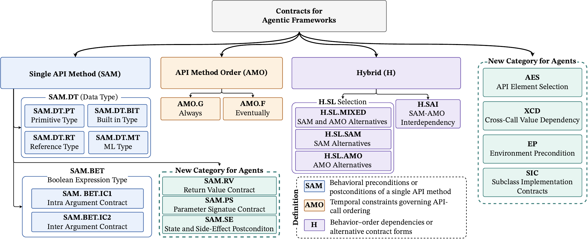

# MINT: software contract mining reviewer artifact

This repository contains the source-specific prompts and supporting code for inferring, normalizing, and reviewing natural-language software contracts from Stack Overflow, GitHub, and Hugging Face developer discussions.

This README is the authoritative guide for this submission. The Python package is `mint`, located in `src/mint`. All linked paths are relative to this repository root. The sections below document the final corpus, dataset selection, retained prompts, output schemas, and final RQ3 classification protocol.

- [Installation](#installation)
- [Sanity tests](#sanity-tests)
- [Run the motivating example](#run-the-motivating-example)
- [Taxonomy: tree and 19 definitions](#taxonomy-tree-and-19-definitions)
- [Model results](#model-results)
- [Source corpus](#source-corpus)
- [Dataset selection and provenance](#dataset-selection-and-provenance)
- [Prompt index](#prompt-index)

The prompt text is preserved from the research source repository. Superseded prompt variants and internal freeze manifests are excluded from this submission copy. Prompt folders are named by developer source or processing stage.

- [Inference prompts](src/mint/agents/Inferrer/prompts) and [output schema](src/mint/agents/Inferrer/schemas/output.py)
- [Normalization prompts](src/mint/agents/normalizer/prompts) and [output schemas](src/mint/agents/normalizer/schemas)
- [Independent contract review prompts](src/mint/agents/reviewer/prompts) and [output schema](src/mint/agents/reviewer/schemas/output.py)
- [Taxonomy prompts](src/mint/taxonomy/prompts) and [taxonomy models](src/mint/taxonomy/models.py)
- [Final source corpus](data/mint_corpus): 576 Stack Overflow discussions, 209 GitHub records, and 60 Hugging Face topics (845 records total). See [Source corpus](#source-corpus) below.

This copy provides the source corpus, saved model results, prompts, and supporting code. It excludes human reviews and raw provider response archives. The motivating-example runner supports offline replay and fresh synchronous OpenRouter runs using the retained prompts. Inspecting the corpus, prompts, and saved results requires no model API access.

## Installation

Download and extract this artifact, then open a terminal in its root folder (the folder containing this README). For example:

```sh
cd /path/to/msr-submission
```

Reading the corpus, saved results, and taxonomy needs no software installation. To run the motivating example, use Python 3.12 and the four dependencies below. A GPU and a local model server are not required.

### 1. Install uv

If `uv --version` already works, continue to step 2. Otherwise use the [official uv installation instructions](https://docs.astral.sh/uv/getting-started/installation/).

**macOS or Linux:**

```sh
curl -LsSf https://astral.sh/uv/install.sh | sh
```

**Windows PowerShell:**

```powershell
powershell -ExecutionPolicy ByPass -c "irm https://astral.sh/uv/install.ps1 | iex"
```

Close and reopen the terminal after installation, return to the artifact root, and check:

```sh
uv --version
```

### 2. Create and activate the Python environment

Run on any supported platform:

```sh
uv venv --python 3.12
```

Activate it on **macOS or Linux**:

```sh
source .venv/bin/activate
```

Activate it on **Windows PowerShell**:

```powershell
.venv\Scripts\Activate.ps1
```

If PowerShell blocks activation, activation can be skipped: use `.venv\Scripts\python.exe` instead of `python` in the commands below. The default `.venv` is still discovered by `uv pip install`. See [uv's environment guide](https://docs.astral.sh/uv/pip/environments/).

### 3. Install the example dependencies

From the artifact root:

```sh
uv pip install "jinja2==3.1.6" "pydantic==2.14.1" "python-dotenv==1.2.4" "requests==2.34.2" "pytest>=9.1.1"
uv run --no-project python --version
uv run --no-project python scripts/run_motivating_example.py --help
```

The four example-library versions above were used for local replay checks. Pytest is installed separately for the reviewer sanity tests; it is not a project development dependency group. The runner imports `mint` directly from `src/mint`; installing the project as a package is not required. Use this minimal installation for the reviewer example. `uv sync` installs the broader research dependency set in `pyproject.toml`, including Torch and Transformers, which the example does not use.

In a new terminal, return to the artifact root and activate `.venv` again. Run `deactivate` when finished with the environment.

## Sanity tests

After installation, run the offline pytest suite from the artifact root:

```sh
uv run --no-project python -m pytest -q
```

The command uses the local `.venv` created above and skips project dependency synchronization. It does not install the research stack or require the removed `dev` dependency group. No `.env`, model account, GPU, network connection, or API credits are needed after dependencies are installed.

The default result is **11 passed, 1 skipped**. The skipped test is the optional local live-configuration check. The suite checks:

- Python 3.12 or newer and the four required library imports.
- Corpus sizes, unique IDs, and the motivating example's source evidence.
- The 19-leaf taxonomy, seven introduced categories, and valid hierarchy.
- Result/corpus ID matching, the paper's contract counts, taxonomy hashes, quality-review indices, and taxonomy-assignment review coverage.
- Jinja syntax, prompt rendering, and source imports.
- The complete 12-stage saved replay, with two normalized contracts and zero model calls. Replay outputs are written to a temporary directory and removed.
- Rejection of a live run without an API key before any provider request.

After filling `.env`, also check local live settings:

```sh
uv run --no-project python -m pytest -q --check-live
```

With valid local settings, the result is **12 passed**. This validates the key field, synchronous model-ID format, positive output-token limit, and finite positive timeout. It makes no provider requests and does not establish account access, available credit, or current model availability; the live runner checks the model catalog before generation.

If a test fails, read the named test and its assertion message. Pytest also prints a pointer to installation and troubleshooting instructions. Use `-x -vv` for the first failure with more detail:

```sh
uv run --no-project python -m pytest -x -vv
```

| Failure | What to do |
| --- | --- |
| `No module named pytest` | Activate the local `.venv` and run `uv pip install "pytest>=9.1.1"`. |
| A dependency import fails | Repeat the dependency installation command in step 3. |
| Python is older than 3.12 | Recreate the local environment using `uv venv --python 3.12`, then reinstall dependencies. |
| A corpus/result count, ID, or taxonomy hash differs | Restore the matching data, results, and taxonomy files from the same artifact; do not change expected counts to force a pass. |
| A prompt is missing or cannot render | Restore `src/mint` from the artifact and rerun the tests. |
| The replay test fails | Run `uv run --no-project python scripts/run_motivating_example.py` and inspect the reported stage error. |
| The optional live-settings test fails | Fill the root `.env` as described below; replace placeholders and check model/token/timeout values. |

## Run the motivating example

[The example runner](scripts/run_motivating_example.py) uses Stack Overflow [#76633836](https://stackoverflow.com/questions/76633836), the paper's `CharacterTextSplitter` example. It reads the discussion from the submitted corpus and supports two modes:

- **Offline replay (default):** reads the saved model outputs from `inferred_contracts/stackoverflow.csv`, validates their schemas and stage alignment, and writes the complete saved flow. It makes zero API calls and requires no credentials. The saved example contains two normalized contracts.
- **Live (`--live`):** makes fresh synchronous OpenRouter requests for three inferences, Opus normalization, Qwen and DeepSeek contract-quality reviews, Sonnet classification against the fixed final taxonomy, and Qwen and DeepSeek assignment reviews for each classified contract. It does not rebuild the taxonomy, execute LangChain, or incorporate human reviews. Fresh outputs can differ from the paper's saved batch results.

### Offline replay

After installation, run from the repository root with the environment active:

```sh
uv run --no-project python scripts/run_motivating_example.py
```

Output is written to `outputs/motivating_example/replay/`. Each stage has a JSON output, and `summary.json` collects the candidates, normalization audit, quality reviews, taxonomy assignments, and assignment reviews. Replay is a validation and presentation of saved results, not a new model execution.

### Configure `.env` for live execution

Offline replay does not require `.env`. For a fresh model run, copy the supplied [`.env.example`](.env.example) to a file named **`.env`** in the artifact root. Edit `.env`; keep `.env.example` as the distributable template.

**macOS or Linux:**

```sh
cp .env.example .env
```

**Windows PowerShell:**

```powershell
Copy-Item .env.example .env
```

Open `.env` in a text editor. Create an API key in your [OpenRouter account](https://openrouter.ai/settings/keys), then replace the empty value on this line with your own key:

```dotenv
OPENROUTER_API_KEY=your_actual_openrouter_api_key
```

Do not include the word `Bearer`, angle brackets, or the example placeholder. Keep one `NAME=value` entry per line. The runner adds the authentication header itself. `.env` is ignored by Git. Never put your real key in `.env.example`. Live requests require an OpenRouter account with access and sufficient credit for the selected models. See the [OpenRouter quickstart](https://openrouter.ai/docs/quickstart).

| Variable | What to enter or keep | Used by |
| --- | --- | --- |
| `OPENROUTER_API_KEY` | Your own OpenRouter API key. Required for live mode; leave unset for replay. | Live runner |
| `OPENROUTER_SITE_URL` | Optional attribution URL; leave empty if you have no site. | Live runner |
| `OPENROUTER_SITE_NAME` | Keep `MINT`, or set a name for request attribution. | Live runner |
| `MINT_GEMINI_MODEL` | Default `google/gemini-3.8-flash`; proposer 1. | Live runner |
| `MINT_SONNET_MODEL` | Default `anthropic/claude-sonnet-5.5`; proposer 2 and taxonomy classifier. | Live runner |
| `MINT_SOL_MODEL` | Default `openai/gpt-6.1-sol`; proposer 3. | Live runner |
| `MINT_NORMALIZER_MODEL` | Default `anthropic/claude-opus-5.5`; consolidates proposer candidates. | Live runner |
| `MINT_QWEN_MODEL` | Default `qwen/qwen3.8-max-0902`; quality and taxonomy-assignment reviewer. | Live runner |
| `MINT_DEEPSEEK_MODEL` | Default `deepseek/deepseek-v4.1-flash`; quality and taxonomy-assignment reviewer. | Live runner |
| `MINT_MAX_OUTPUT_TOKENS` | Keep `8000` initially; positive maximum output tokens per generation request, not a dollar budget. | Live runner |
| `MINT_REQUEST_TIMEOUT_SECONDS` | Keep `300` initially; positive timeout in seconds for generation requests. | Live runner |
| `OLLAMA_HOST` | Keep `http://127.0.0.1:11434`; ignored by the example runner. | Separate local inference CLI |
| `OLLAMA_TIMEOUT_SECONDS` | Keep `300`; ignored by the example runner. | Separate local inference CLI |
| `INFERRER_MAX_ATTEMPTS` | Keep `3`; ignored by the example runner, which does not automatically retry generation. | Separate local inference CLI |

The model IDs are recorded defaults, not a guarantee of current availability. The runner checks the provider's catalog before generation; if an ID is no longer available, choose an available structured-output model for that role from the [OpenRouter model catalog](https://openrouter.ai/models) and update `.env`. Use synchronous IDs without `:batch`. Changing a model makes this a new execution configuration; it does not replace the saved paper results.

The runner loads `.env` without overriding existing shell environment variables. If an edited value appears to be ignored, check whether that variable is already set in your shell. An alternate file can be supplied with `--env-file PATH`.

### Start a live run

With the environment active and `.env` filled in:

```sh
uv run --no-project python scripts/run_motivating_example.py --live --output-dir outputs/motivating_example/live
```

Live mode uses paid API calls. It checks configured model IDs and structured response support against the provider catalog before generation. Update the model IDs in `.env` if a recorded model is unavailable; use synchronous IDs without the `:batch` suffix. For two classified contracts, the complete flow makes 12 generation requests. The request count changes with the number of normalized and classified contracts.

Live stages retain requests, raw responses, usage counters, elapsed time, and validated outputs. Requests contain prompts and generation settings, not the API key. Reusing the same `--output-dir` reuses matching successful stages and saved responses; changed requests fail instead of silently overwriting prior work. No automatic generation retries are performed. If a saved response is incomplete or invalid, the runner stops for inspection rather than silently issuing another paid request. Keep live and replay output directories separate.

The runner validates inference schemas, normalization candidate coverage, contract-review indices, taxonomy identity and terminal leaves, and assignment review consistency. These checks establish structural consistency; model agreement does not independently prove contract correctness.

### Troubleshooting

| Symptom | Action |
| --- | --- |
| `uv` is not found | Reopen the terminal after installation and check `uv --version`. |
| A Python import is missing | Activate the environment, then repeat the four-package install command from the artifact root. |
| `OPENROUTER_API_KEY` is missing | Save the key in the root `.env`, not `.env.example`; check `--env-file` if using another location. |
| A model is unavailable or lacks structured-output support | Update that model's role variable in `.env` using a supported synchronous ID. |
| Authentication, credit, or rate-limit error | Check the OpenRouter account/key and provider error; the runner does not automatically retry paid generations. |
| A saved response is incomplete or invalid | Inspect the stage's `.response.json`; use a new output directory for an intentional fresh run after adjusting settings. |
| A changed request conflicts with saved output | Choose a new `--output-dir`; an existing successful stage is reused only when the request matches. |
| You only want the paper's saved example | Run without `--live`; no key or network access is needed after dependencies are installed. |

## Model results

Each CSV contains one row per developer instance and 41 columns. Instances with no inferred contracts remain included. The three files contain **845 instances and 1,043 normalized contracts**, with no human-review annotations or human-corrected labels joined into the results.

| Results CSV | Instances | Instances with normalized contracts | Normalized contracts | Classified contracts |
| --- | ---: | ---: | ---: | ---: |
| [stackoverflow.csv](inferred_contracts/stackoverflow.csv) | 576 | 481 | 716 | 576 |
| [github.csv](inferred_contracts/github.csv) | 209 | 143 | 266 | 171 |
| [huggingface.csv](inferred_contracts/huggingface.csv) | 60 | 43 | 61 | 50 |
| Total | 845 | 667 | 1,043 | 797 |

These counts were checked against the model-based results in [the paper](paper/_MSR27__MINT.pdf), Sections IV-B through IV-D. The human evaluation in Section V is outside these exports.

### Column guide

| Columns | Content |
| --- | --- |
| `source`, `instance_id`, `framework`, `artifact_type`, `source_url` | Source record identity and original framework metadata. |
| `infer_gemini_*`, `infer_sonnet_*`, `infer_sol_*` | Each proposer's model, decision, contracts and APIs, rationale, status. |
| `normalization_*` | Opus model, decision, normalized contracts and APIs, contract count, rationale, candidate lineage/audit, status. |
| `taxonomy_assignments` | Sonnet's final decision for every normalized contract, including its stable contract ID, zero-based normalized index, leaf or competing leaves, justification, evidence quote, taxonomy identity, model, and execution status. |
| `taxonomy_seed_assignments` | Historical seed-taxonomy decisions and rationales for the 716 Stack Overflow contracts; blank for the other sources. |
| `taxonomy_qwen_reviews`, `taxonomy_deepseek_reviews` | Anchored taxonomy-assignment reviews for classified contracts, retaining ACCEPT/ALTERNATIVE, suggested and reconstructed leaves, reasons, and model. |
| `judge_qwen_*`, `judge_deepseek_flash_*` | Contract-quality reviews: evidence support, API correctness, per-contract rationale, and instance-level completeness with rationale and missing requirements. Model, saved status, and validation method are retained. |

Nested arrays and objects are stored as JSON inside properly quoted CSV cells. Parse those cells with a JSON reader; do not split them on commas. Per-contract quality reviews use `contract_index`, which refers to the zero-based position in `normalization_contracts`. Taxonomy entries use the same position through `normalized_index` and retain the original `contract_id`.

Empty arrays mean no applicable contract-level entries. In particular, instances without contracts still have completeness reviews, and ambiguous/unclassified taxonomy decisions do not receive anchored assignment reviews. The saved `accepted_uncertain` contract-quality review status is preserved for 12 assessments, rather than converted to unqualified approval. Existing reconciled quality reviews and technically accepted taxonomy outputs are exported as saved; technical acceptance and model agreement do not establish independent correctness.

### Result provenance

The saved MINT outputs are from the `contracts_mining` research checkout. The inspected `contract_agent` checkout contains HumanEval/xCodeEval results, which do not match this paper's corpus. No results from that checkout are used.

The tables combine the saved instance/contract rosters, three inference result sets, final normalization outputs, and reconciled Qwen and DeepSeek quality reviews. Taxonomy fields retain the final classifications and successful assignment reviews. Historical seed assignments are supplied for the Stack Overflow comparison. Internal prompt revision labels and research-workspace locator columns are omitted from the reviewer tables. Taxonomy identity fields remain available for matching the seed and final classification protocols.

## Source corpus

`data/mint_corpus` contains the final developer evidence used for inference and the RQ1 analysis: **845 records** across three sources. These are source discussions and artifacts; they are not generated contracts or model evaluation results.

| Corpus file | Source | Records |
| --- | --- | ---: |
| [stackoverflow_corpus.csv](data/mint_corpus/stackoverflow_corpus.csv) | Stack Overflow | 576 |
| [github_corpus.jsonl](data/mint_corpus/github_corpus.jsonl) | GitHub issues and commits | 209 |
| [huggingface_corpus.jsonl](data/mint_corpus/huggingface_corpus.jsonl) | Hugging Face forum topics | 60 |

All three ID rosters were crosschecked against the saved RQ1 instance roster in the research source repository. GitHub and Hugging Face JSONL files are byte-for-byte copies of their research inputs. Each line is a JSON record containing its original identifier, source, artifact type, source URL, and developer evidence. GitHub records retain the original annotation-record unit: repeated artifact URLs can represent distinct records and have not been deduplicated by URL.

The Stack Overflow CSV retains its original columns and metadata. Its `title`, `body`, and `accepted_answer` fields and record order are taken from the saved consolidator input used by the analysis. Mixed newline sequences in three accepted answers are preserved from the saved input. Every final discussion field was checked for exact equality with CSV newline translation disabled. The CSV contains one unique developer post ID per row.

The Stack Overflow CLI defaults to this folder and reads metadata directly from the self-contained CSV. The GitHub and Hugging Face records require their source-specific prompts and evidence handling; the Stack Overflow CSV CLI does not process those JSONL files.

Raw caches, smoke-test subsets, calibration datasets, intermediate enrichment files, historical preparation scripts, and duplicate source sheets are excluded from this submission copy. The research source repository is unchanged.

## Taxonomy: tree and 19 definitions

[](figures/taxonomy-tree.pdf)

Click the figure to open the [full-size vector PDF](figures/taxonomy-tree.pdf). The PNG is a rendering of that PDF so the tree is visible directly in Markdown.

The final taxonomy has **19 terminal categories: 12 seed categories and seven MINT extensions**. SAM means Single API Method, AMO means API Method Order, and H means Hybrid. DT and BET are grouping branches for Data Type and Boolean Expression Type; SL groups alternative forms. Grouping branches are not assignable terminal categories.

The table reproduces each terminal definition from the [packaged taxonomy](src/mint/taxonomy/prompts/classification/taxonomy.json). The JSON also supplies inclusion/exclusion criteria. IDs retain `MINT.` for introduced leaves; the figure omits that prefix for compact display. “Root” means a top-level category.

| Leaf ID | Category | Parent | Origin | Definition |
| --- | --- | --- | --- | --- |
| `SAM.DT.PT` | Primitive Type | SAM.DT | Seed | A single API method constrains an argument to a primitive type. |
| `SAM.DT.BIT` | Built-in Type | SAM.DT | Seed | A single API method requires a built-in compound type. |
| `SAM.DT.RT` | Reference Type | SAM.DT | Seed | An argument requires a referenced object, function, or class-typed value. |
| `SAM.DT.MT` | ML Type | SAM.DT | Seed | An argument requires an ML-domain tensor or multidimensional-array type or dtype. |
| `SAM.BET.IC1` | Intra-argument Contract | SAM.BET | Seed | A logical or value constraint on one argument of one API method. |
| `SAM.BET.IC2` | Inter-argument Contract | SAM.BET | Seed | A relationship across two or more arguments of the same API method. |
| `AMO.G` | Always | AMO | Seed | An always-required temporal API ordering or obligation in its applicable execution context. |
| `AMO.F` | Eventually | AMO | Seed | A method call or ordering obligation must occur at a subsequent point in execution. |
| `H.SAI` | SAM-AMO Interdependency | H | Seed | A behavior, argument, or state condition and API-call order constrain each other. |
| `H.SL.SAM` | Selection - SAM alternatives | H.SL | Seed | Multiple acceptable behavioral or SAM ways can satisfy the obligation. |
| `H.SL.AMO` | Selection - AMO alternatives | H.SL | Seed | Multiple acceptable temporal or API-order ways can satisfy the obligation. |
| `H.SL.MIXED` | Selection - SAM and AMO alternatives | H.SL | Seed | Behavioral and temporal/order forms are alternatives for satisfying one obligation. |
| `MINT.SAM.RV` | Return Value Contract | SAM | MINT extension | A postcondition of a single API method on the value it returns. It covers the returned value's type, structure, field location, access form (attribute versus subscript, element versus array), or content guarantees, and the caller's obligation to consume the result in that form. |
| `MINT.SAM.PS` | Parameter Signature Contract | SAM | MINT extension | A precondition of a single API method on its parameter interface. It covers which parameter names or keys are recognized or allowed, the permitted set of request parameters or properties, the number of positional arguments, and the passing mode (positional versus keyword). It applies independently of the type or value of any argument. |
| `MINT.AES` | API Element Selection | Root | MINT extension | An obligation that identifies which API element must, or must not, be invoked, instantiated, imported, or targeted to accomplish a task. The element may be a method, class, constructor or factory, endpoint, exported symbol, or module path. The choice may be conditioned on usage context such as the model kind, sync versus async usage, or the library version in use. |
| `MINT.EP` | Environment Precondition | Root | MINT extension | A precondition for an API call, construction, or import to succeed that constrains the execution environment rather than the call. The environment includes installed packages and their versions or compatible pairs, the runtime or language version, the execution platform (server versus browser, edge versus Node, OS), project files or name shadowing, and build or deployment configuration. It also includes the state of external services and accounts: deployed model, region, or tier, server plugins and schema, credentials scope, quota, billing, and rate limits. |
| `MINT.SAM.SE` | State and Side-Effect Postcondition | SAM | MINT extension | A postcondition of a single API method on an effect the caller can observe other than the returned value. The effect may be persisted or in-memory state the method creates, modifies, preserves, or deletes; files or log records it writes and their location or content; callbacks or notifications it emits; or owned resources it acquires or releases. |
| `MINT.XCD` | Cross-Call Value Dependency | Root | MINT extension | An obligation that a value supplied to one API call must be identical to, derived from, or explicitly forwarded from a value supplied to or produced by a different API call or pipeline stage. The substance of the obligation is which value flows between the calls, not the order in which the calls occur. |
| `MINT.SIC` | Subclass Implementation Contract | Root | MINT extension | An obligation on how a caller-defined subclass or implementation of an API-provided base class or interface must be declared so that the API accepts or can instantiate it. It covers abstract members that must be implemented, the required decorator or kind of a member (for example classmethod), and the required declaration form of state (for example class-level annotated fields rather than attributes assigned in \_\_init\_\_). |

## Dataset selection and provenance

The selection rules below were crosschecked against the historical preparation code and saved inputs. References to original files identify provenance; the submitted corpus files linked above are the datasets supplied for review.

- Stack Overflow: `stack_overflow_candidate.py` selects source rows whose `accepted_answer` flag is true, keeps the first classification per post ID, and joins the first title/body record per ID. Reapplying this selection to the original `agent_dataset` yields 700 candidate IDs. The final 576 IDs are a subset of those candidates. The historical saving step retains records with nonempty retrieved accepted answers; reproducing the exact final snapshot requires the saved answers, rather than fetching current answers.
- Hugging Face: `enrich_huggingface_dataset.py` selects source rows whose `accepted_answer` flag is true and retains the first row per canonical forum topic ID. Reapplying this selection yields exactly the 60 topic IDs in the submitted corpus. Source labels and live accepted-solution status are separate fields in the historical enrichment workflow.
- GitHub: `enrich_github_dataset.py`, `finalize_github_dataset.py`, and `validate_github_enrichment.py` collect, filter, and validate source evidence. The saved final manifest records 72 included issue annotation rows and 140 included commit annotation rows, represented by 69 issue inference records and 140 commit inference records (209 total). It separately records three excluded annotation rows. Annotation rows and inference records are different counting units.

Historical preparation and calibration scripts and the original `agent_dataset` sheets are excluded from this submission. The single submitted dataset folder is `data/mint_corpus`; it contains the verified final snapshot.

## Prompt index

The templates below are copied without changing their wording from the research source repository, `contracts_mining`. Paths are relative to this submission root. Each `.j2` pair contains a system prompt and a user template; values are inserted with the Jinja renderer in `src/mint/llm/prompt_renderer.py`. Folders identify developer sources and pipeline stages without internal prompt revision numbers.

### Inference

| Developer source | Templates |
| --- | --- |
| Stack Overflow | [system](src/mint/agents/Inferrer/prompts/stackoverflow/system.j2), [user](src/mint/agents/Inferrer/prompts/stackoverflow/user.j2) |
| GitHub | [system](src/mint/agents/Inferrer/prompts/github/system.j2), [user](src/mint/agents/Inferrer/prompts/github/user.j2) |
| Hugging Face | [system](src/mint/agents/Inferrer/prompts/huggingface/system.j2), [user](src/mint/agents/Inferrer/prompts/huggingface/user.j2) |

Inference extracts evidence-supported obligations and associated APIs, with explicit outcomes for no contract or insufficient evidence. The supplied source content is evidence to analyze. It is not an instruction to execute. The structured response is defined by [`InferenceOutput`](src/mint/agents/Inferrer/schemas/output.py).

### Normalization

| Developer source | Templates |
| --- | --- |
| Stack Overflow | [system](src/mint/agents/normalizer/prompts/stackoverflow/system.j2), [user](src/mint/agents/normalizer/prompts/stackoverflow/user.j2) |
| GitHub | [system](src/mint/agents/normalizer/prompts/github/system.j2), [user](src/mint/agents/normalizer/prompts/github/user.j2) |
| Hugging Face | [system](src/mint/agents/normalizer/prompts/huggingface/system.j2), [user](src/mint/agents/normalizer/prompts/huggingface/user.j2) |

Normalization consolidates candidate obligations against the original evidence, merges duplicates, and retains candidate lineage. Source-specific schemas are in [`normalizer/schemas`](src/mint/agents/normalizer/schemas). The Stack Overflow results use the final audited normalization output.

### Independent contract review

| Developer source | Templates |
| --- | --- |
| Stack Overflow | [system](src/mint/agents/reviewer/prompts/stackoverflow/system.j2), [user](src/mint/agents/reviewer/prompts/stackoverflow/user.j2) |
| GitHub | [system](src/mint/agents/reviewer/prompts/github/system.j2), [user](src/mint/agents/reviewer/prompts/github/user.j2) |
| Hugging Face | [system](src/mint/agents/reviewer/prompts/huggingface/system.j2), [user](src/mint/agents/reviewer/prompts/huggingface/user.j2) |

The review agent supplies the source evidence and indexed normalized contracts. Its structured response is defined in [`reviewer/schemas/output.py`](src/mint/agents/reviewer/schemas/output.py). Internal `.freeze.json` metadata and the corresponding validation method are excluded from this submission copy.

### Taxonomy refinement and final classification

See the [taxonomy figure and all 19 definitions](#taxonomy-tree-and-19-definitions) above.

These stages serve different purposes. Refinement proposes taxonomy extensions; final classification assigns an existing terminal leaf without modifying the tree.

| Stage | Prompt |
| --- | --- |
| Refinement classification | [system](src/mint/taxonomy/prompts/refinement/classifier_system.j2), [user](src/mint/taxonomy/prompts/refinement/classifier_user.j2) |
| Extension design | [system](src/mint/taxonomy/prompts/refinement/designer_system.j2), [user](src/mint/taxonomy/prompts/refinement/designer_user.j2) |
| Final single-contract classification | [system](src/mint/taxonomy/prompts/classification/system.j2), [user](src/mint/taxonomy/prompts/classification/user.j2) |
| Assignment review | [system](src/mint/taxonomy/prompts/assignment-review/system.j2), [user](src/mint/taxonomy/prompts/assignment-review/user.j2) |

The final classification [19-leaf taxonomy](src/mint/taxonomy/prompts/classification/taxonomy.json) and [response schema](src/mint/taxonomy/prompts/classification/response-schema.json) retain the categories and response fields from the research audit. Internal taxonomy revision labels are standardized to `emse2023_seed`, `mint_refinement`, and `mint_final`; saved identity fields and the packaged taxonomy hash are aligned with those labels. Category definitions, assignments, and rationales are unchanged. Both system prompts use Jinja templates, and their user templates receive the serialized JSON payload through `payload_json`.

The final classification user message is a JSON object serialized with `json.dumps(..., ensure_ascii=False)`. Its fields are `taxonomy_version`, `taxonomy_hash`, `taxonomy`, sorted `terminal_leaf_ids`, and `contract`. The contract object contains `contract_id`, `contract`, `apis`, `source_context_excerpt`, and `context_truncated`. This structure follows `scripts/rq3_singleton.py:make_request` in the research source. The taxonomy hash is the SHA-256 of the frozen taxonomy file used by the request.

Assignment review supplies a JSON object containing `contract`, `associated_apis`, `framework`, `developer_source`, `source_evidence_excerpt`, `evidence_truncated`, `original_assignment`, `frozen_taxonomy`, and sorted `permissible_leaf_ids`. `original_assignment` contains the assigned node's `id`, `name`, `definition`, `inclusion_criteria`, and `exclusion_criteria`. This follows `scripts/rq3_assignment_review.py:request_for` in the research source.

The earlier seed and retry prompts used for historical comparisons are not included in this final-prompt collection. Reproducing those comparisons requires the corresponding historical prompts, payloads, and outputs from the research archive. A final prompt alone does not reproduce a reported result.
